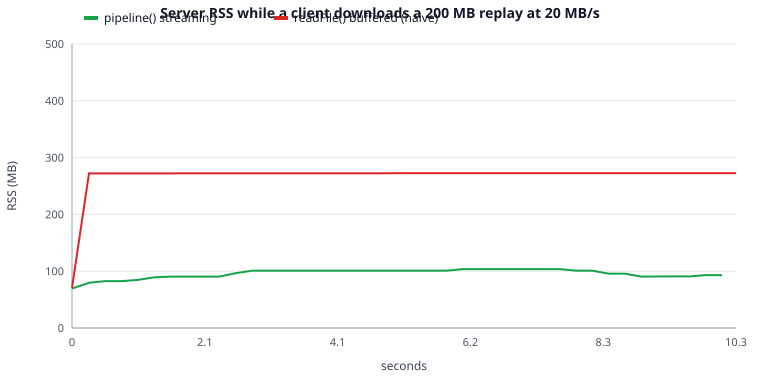

# Lab 04 — Node.js server, streams and WebSockets

Лабораторна додає **game server** на Node.js. Він віддає зібраний клієнт, керує кімнатами, приймає WebSocket-з'єднання (join / leave / chat), пише логи матчів на диск потоками і захищається від зловживань. Синхронізація стану гри — це Lab 05; тут гра ще локальна, а мережею ходять roster і чат.

Клієнт із Lab 01–03 перенесено в `client/`, сервер — у `server/`; корінь репозиторію — npm workspaces.

## Структура

```text
package.json                    workspaces: client, server
client/                         Vite-застосунок з Lab 01–03
  src/net/connection.js         WebSocket-обгортка: dispatch за type, send queue, reconnect з backoff
  src/net/session.js            joinRoom() -> { connection, welcome }
  src/chat/panel.js             roster + чат (лише textContent, без innerHTML)
server/
  src/index.js                  createApp(), listen, graceful shutdown (SIGINT/SIGTERM)
  src/config.js                 валідовані змінні середовища
  src/http.js, src/static.js    node:http без фреймворків, MIME + захист від path traversal
  src/rooms.js                  Room extends EventEmitter, RoomManager
  src/protocol.js               протокол v0: типи повідомлень, версія, валідація, close-коди
  src/ws.js                     lifecycle сокета: join-timeout, heartbeat, rate limit, slow-client policy
  src/ratelimit.js              token bucket
  src/log/matchlog.js           object-mode Transform -> NDJSON через pipeline()
  src/log/replay.js             async generator / Readable над NDJSON-файлом
  test/                         35 тестів (node:test)
  scripts/                      експерименти (backpressure, блокування event loop, crash)
```

## M1 — HTTP-сервер і API

- `node:http`, без фреймворків. Статика з правильними MIME-типами; шлях декодується, перевіряється на `\0` і резолвиться під `CLIENT_DIR` — вихід за корінь дає `403`.
- `GET /api/rooms`, `POST /api/rooms` (валідація, ліміт тіла `MAX_BODY_BYTES`, `413` при перевищенні, `415` без `application/json`, `409` дублікат, `429` ліміт кімнат), `GET /health`, `GET /api/stats` (RSS, event-loop delay, лічильники).
- Конфіг із `process.env` через `config.js`: усі значення валідуються, усі помилки показуються разом (`ConfigError`). Для dev: `node --watch --env-file-if-exists=.env`.
- Vite у dev проксіює `/api` і `/ws` на сервер (`SERVER_PORT`, за замовчуванням 3000).
- **Graceful shutdown**: `server.close()` (перестає приймати з'єднання) → всі сокети закриваються кодом `1001` → match-логи дописуються й закриваються → `exit 0`; якщо не вклалися в `SHUTDOWN_TIMEOUT_MS` — `exit 1`. Покрито тестом `shutdown.test.js` (реальний child-процес + SIGTERM).

## M2 — кімнати і WebSocket

- `Room extends EventEmitter` — події `join`, `leave`, `chat`, `empty`; нічого не знає про сокети. `RoomManager` видаляє порожні кімнати (крім `persistent` — три стартові кімнати з Lab 03).
- Після підключення клієнт мусить за `JOIN_TIMEOUT_MS` (5 с) надіслати `join`, інакше сокет закривається кодом `4002`.
- Кожне повідомлення проходить `parseClientMessage()`: невалідний JSON / версія / поля → `4000`, невідомий тип → `4001`; завеликий фрейм обриває сама бібліотека (`maxPayload`, код `1009`). Бінарні фрейми відхиляються.
- Roster розсилається при join/leave, чат — усій кімнаті.
- Heartbeat: `ping` кожні 15 с, сокет, що пропустив 2 `pong`, робить `terminate()`. На кожному сокеті є `error`-listener.
- Клієнт: `Connection` (dispatch за `type`, черга відправки поки сокет не відкритий, reconnect з exponential backoff + jitter, після reconnect повторно надсилається `join`). На фатальні коди (`4000–4005`, `1009`) автоперепідключення вимкнене.

**Перевірка «два вікна в одній кімнаті»** автоматизована тестом `two clients join the same room, see each other and chat` (два WebSocket-клієнти бачать імена один одного й чат). Ручну перевірку в двох вкладках браузера слід зробити під час демонстрації: `npm run dev`, дві вкладки, одна кімната.

### Протокол v0

| Напрям | Повідомлення                                                                                                                              |
| ------ | ----------------------------------------------------------------------------------------------------------------------------------------- |
| C → S  | `{v:0, type:"join", roomId, name}` · `{type:"chat", text}` · `{type:"leave"}`                                                             |
| S → C  | `{type:"welcome", playerId, room, roster}` · `{type:"roster", roster}` · `{type:"chat", from, text, t}` · `{type:"error", code, message}` |

| Код  | Значення                       |
| ---- | ------------------------------ |
| 1001 | сервер зупиняється             |
| 1009 | фрейм завеликий (`maxPayload`) |
| 4000 | некоректне повідомлення        |
| 4001 | невідомий тип                  |
| 4002 | не було `join` вчасно          |
| 4003 | перевищено rate limit          |
| 4004 | кімнати немає / вона повна     |
| 4005 | повільний клієнт               |

## M3 — match logs як streams

- Кожна кімната, коли в ній з'являється перший гравець, відкриває `LOG_DIR/<room>-<timestamp>.ndjson`: `Transform` в object-режимі перетворює події на NDJSON-рядки, а `pipeline(transform, fileStream)` стежить за помилками і backpressure. Коли кімната порожніє, файл закривається.
- `replay.js` — async generator (`readline` над `createReadStream`) із повідомленням про номер зіпсованого рядка (`ReplayParseError`) і `Readable.from(...)`-обгортка.
- `GET /api/replays/:id` стрімить файл через `pipeline(createReadStream(file), res)` — без буферизації. `id` валідується регуляркою і перевіряється, що шлях лишається в `LOG_DIR`.

### Backpressure-експеримент (200 MB)

`node server/scripts/backpressure-demo.mjs`: скрипт генерує 200 MB NDJSON, запускає сервер окремим процесом і викачує файл клієнтом, який читає не швидше за **20 MB/s** (пауза сокета). RSS сервера семплюється з `/api/stats` кожні 250 мс. Для порівняння той самий файл віддається навмисно наївним `readFile()` (`?buffered=1`, лише при `DEBUG_ROUTES`).



| Варіант                | RSS на старті | Пік RSS  |
| ---------------------- | ------------- | -------- |
| `pipeline()` streaming | 69.5 MB       | 103.7 MB |
| `readFile()` (naive)   | 70.6 MB       | 272.5 MB |

RSS при streaming виходить на плато ≈ +35 MB (буфери потоку й аллокатор) і **не залежить від розміру файлу**; naive-варіант тримає весь файл у пам'яті (+200 MB). Сирі дані: [`lab-04/rss.csv`](lab-04/rss.csv).

## M4 — захист від зловживань

- **Rate limit**: token bucket на з'єднання (`RATE_CAPACITY=20`, `RATE_REFILL_PER_SEC=10`); перевищення → закриття кодом `4003` (тест: клієнт-флудер).
- `maxPayload` = 2 KiB на WebSocket, 4 KiB на HTTP-тіло.
- Ліміти: `MAX_ROOMS`, `MAX_PLAYERS_PER_ROOM` (+ `maxPlayers` кімнати).
- **Slow-client policy** (`safeSend` у `ws.js`): якщо `socket.bufferedAmount` > `MAX_BUFFERED_BYTES`, некритичні повідомлення (чат) відкидаються; якщо > 4× — з'єднання закривається кодом `4005`. Критичні (`welcome`, `roster`, `error`) завжди ставляться в чергу.

## Write-up

### Event loop: блокування `/api/slow`

`node server/scripts/blocking-demo.mjs`: клієнт A шле чат кожні 50 мс, клієнт B вимірює затримку доставки. На 1.5-й секунді викликається `GET /api/slow?block=300` — синхронний busy-loop на 300 мс.

| Сценарій       | повідомлень | p50    | max          |
| -------------- | ----------- | ------ | ------------ |
| без блокування | 79          | 0.9 ms | 2.8 ms       |
| блок 300 ms    | 79          | 0.9 ms | **262.3 ms** |

Один HTTP-запит «заморозив» усі кімнати: Node виконує JavaScript в одному потоці, поки `while` крутиться, event loop не доходить ні до `poll`-фази зі зверненнями сокетів, ні до таймерів. Повідомлення не губляться — вони чекають у черзі, тому p50 не змінився, але хвіст затримки зріс у ~100 разів. Дані: [`lab-04/blocking-demo.json`](lab-04/blocking-demo.json). Для цього сервера це головна причина, чому важку роботу не можна робити синхронно в обробниках (у Lab 07 — worker threads / профілювання).

### Backpressure

Де це проявилося: у M3, коли повільний клієнт тягне великий replay. `res.write()` повертає `false`, коли внутрішній буфер заповнений; `pipeline()` у цей момент ставить `createReadStream` на паузу і відновлює його на `drain`. Тому пам'ять обмежена розміром буферів, а не файлом (див. графік). Без цього (`readFile` або `data`-handler без пауз) пам'ять росте до розміру файлу × кількість клієнтів. Ту саму ідею використовує `safeSend` для WebSocket: `bufferedAmount` — це «backpressure» сокета.

### Чому unhandled `error` / rejection валить сервер

`node server/scripts/crash-demo.mjs` → [`lab-04/crash-excerpt.txt`](lab-04/crash-excerpt.txt):

```text
### 1. EventEmitter 'error' without a listener
exit code: 1
Error: ECONNRESET: peer reset the connection
Emitted 'error' event at: ...

### 2. Unhandled promise rejection in an async handler
exit code: 1
Error: room lookup failed
```

`EventEmitter` вважає подію `error` особливою: якщо listener-а немає, її кидають як звичайний `throw` у місці `emit`, а оскільки ніхто не перехопив — це `uncaughtException` і процес завершується. Аналогічно в Node ≥ 15 необроблений rejected Promise → `uncaughtException`. Один обірваний сокет міг би вбити сервер для всіх кімнат. **Виправлення**: `socket.on("error", …)` на кожному сокеті (див. `ws.js`) і `.catch()`/`await` у кожному async-обробнику; у http-обробнику весь `route()` обгорнуто в `.catch`, що повертає `500` (випадок 3 у логу — процес живий).

## Відповіді на reflection-питання

1. **Фази event loop**: timers → pending callbacks → idle/prepare → **poll** (I/O) → check (`setImmediate`) → close callbacks. `process.nextTick` і promise-колбеки (microtasks) виконуються між операціями поточної фази, до переходу далі, `nextTick` раніше за promises.
2. **Читання файлів без блокування**: JS-потік віддає запит libuv; файлові операції, DNS, crypto, zlib виконує **thread pool** libuv (4 потоки за замовчуванням), після завершення колбек потрапляє в poll-чергу. Мережеві сокети обробляються через epoll/kqueue без пулу.
3. **CommonJS vs ESM**: `require` синхронний і динамічний, `import` статичний і асинхронний (є top-level `await`); ESM суворий режим за замовчуванням; імпорти — live bindings, а `require` — копія `module.exports`. `__dirname` замінюють `import.meta.url` + `fileURLToPath` (або `import.meta.dirname`).
4. **Backpressure**: споживач повільніший за виробника; `write()` повертає `false` = «буфер повний, чекай `drain`». `pipeline` робить паузу джерела й відновлює його, та ще й коректно знищує всі потоки при помилці.
5. **Типи потоків**: Readable, Writable, Duplex (обидва напрямки, незалежні), Transform (Duplex, де вихід обчислюється з входу). TCP-сокет — **Duplex**.
6. **WebSocket handshake**: HTTP `GET` з `Upgrade: websocket`, `Sec-WebSocket-Key`; сервер відповідає `101 Switching Protocols` із `Sec-WebSocket-Accept` (SHA-1 від ключа + GUID); далі — двонапрямні фрейми по тому ж TCP. Порівняно з polling немає накладних заголовків і затримки опитування; порівняно з SSE — повний дуплекс і бінарні дані.
7. **`error` listener**: див. вище; еквівалент для Promise — `.catch()` / `try/await` (і `unhandledRejection` як остання лінія оборони).
8. **Клієнт на 2G і 30 snapshot/с**: сокет не встигає, `bufferedAmount` росте, пам'ять сервера лінійно збільшується (на кожного такого клієнта). Виявляється через `bufferedAmount`; лікується відкиданням застарілих snapshot-ів або закриттям з'єднання (наша slow-client policy) — у Lab 05 це буде критично.
9. **Валідація на сервері**: клієнт не є довіреним — його можна підмінити, написати власний, надіслати сміття; сервер валідує форму, розмір і частоту кожного повідомлення.

## Definition of Done

- [x] Зібраний клієнт + JSON API + `/health`; конфіг з env; graceful shutdown
- [x] Rooms на `EventEmitter`; валідований JSON-протокол v0; heartbeat; чат у двох клієнтів (автотест)
- [x] Reconnect з backoff і send queue на клієнті
- [x] NDJSON match logs (object-mode Transform + `pipeline`); streaming replay; графік RSS
- [x] Rate limit, payload caps, slow-client policy; write-up з демонстрацією блокування і crash-and-fix
- [ ] Git tag `lab-04` — ставиться після merge PR:

```bash
git tag lab-04
git push origin lab-04
```
